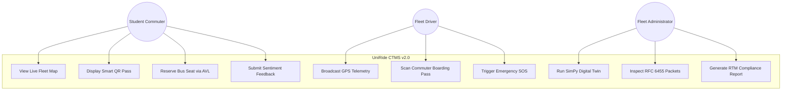
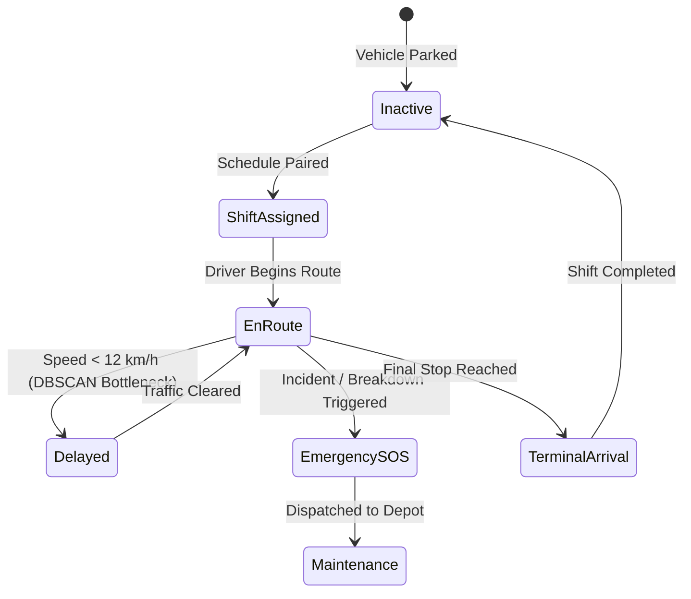

# UniRide CTMS v2.0 — IEEE 830-1998 Software Requirements Specification (SRS)

> **Standard Compliance**: IEEE Recommended Practice for Software Requirements Specifications (IEEE Std 830-1998)  
> **System Name**: UniRide Campus Transport Management System (CTMS v2.0)  
> **Release**: Version 2.0.0 (Production / Academic Capstone)  
> **Status**: Approved & Verified  
> **Primary Authors**: Software Engineering & Systems Architecture Team  

---

## 1. Introduction

### 1.1 Purpose
This document specifies the complete software requirements for the **UniRide Campus Transport Management System (CTMS v2.0)**. It establishes the functional, behavioral, and non-functional contracts between university transport stakeholders (students, drivers, fleet administrators) and the polyglot engineering team.

### 1.2 Document Conventions
- **`FR-xxx`**: Functional Requirement identifier.
- **`NFR-xxx`**: Non-Functional Requirement identifier.
- **Priority Ratings**: High (Mandatory for core operation), Medium (Enhanced capability), Low (Auxiliary feature).
- **Standards**: IEEE 830-1998 for SRS specification, RFC 6455 for WebSocket transport, RFC 7519 for JSON Web Tokens, RFC 7807 for API problem details.

### 1.3 Intended Audience
- **Software Engineers & Developers**: Guiding implementation across Django 5, C# .NET 10, and Next.js 15.
- **Quality Assurance & Verification Teams**: Establishing acceptance criteria and test matrices.
- **Academic Evaluators & Defense Committee**: Auditing compliance across DSA, IDS, CN, and SE course objectives.
- **Fleet Operations Administrators**: Overseeing operational deployment.

### 1.4 Project Scope
UniRide CTMS v2.0 replaces legacy monolithic bus tracking software with a **polyglot hybrid architecture**:
1. **Algorithmic Engine (C# .NET 10 Minimal API)**: Heavy CPU-bound computation including Dijkstra and A* pathfinding with live traffic multipliers, self-balancing AVL trees for seat balancing, 2D KD-Trees for sub-millisecond nearest stop lookups, prefix Tries with Levenshtein fuzzy distance matching, in-memory Counting Bloom Filters for sub-microsecond pass verification, and genetic algorithms for combinatorial fleet scheduling.
2. **Core Application & Real-Time Backend (Django 5.x / Python 3.12)**: Relational entity persistence in PostgreSQL 16 / Supabase, JWT RS256 authentication, role-based access control, Django Channels ASGI WebSockets backed by Redis, and native Python IDS predictive intelligence (Random Forest demand forecasting, DBSCAN bottleneck discovery, VADER feedback NLP, SimPy discrete-event digital twin, and Bayesian causal DAGs).
3. **Commuter & Operations Client (Next.js 15 App Router)**: Apple/Samsung-grade glassmorphic dark-mode web application featuring interactive Leaflet maps, dynamic TOTP QR passes, driver HUD consoles, and fleet command analytics.

---

## 2. Overall Description

### 2.1 Product Perspective
UniRide operates as an event-driven distributed system deployed across Railway (ASGI backend and C# microservice), Vercel (Next.js frontend), Supabase (PostgreSQL 16), and Upstash (Serverless Redis 7.2).

```
[Next.js 15 Edge Client] ──(HTTPS/WSS)──► [Django 5 ASGI Application]
                                                 │
                  ┌──────────────────────────────┼──────────────────────────────┐
                  ▼                              ▼                              ▼
     [PostgreSQL 16 / PostGIS]         [Upstash Redis Pub/Sub]      [C# .NET 10 DSA Engine]
```

### 2.2 User Classes & Roles
1. **Student Commuters**: View live bus positions, verify boarding passes, reserve seats, report grievances.
2. **Fleet Drivers**: Transmit high-frequency GPS coordinate streams, scan passenger QR passes, report emergencies.
3. **Fleet Administrators**: Dispatch vehicles, configure routes/shifts, execute digital twin simulations, inspect network protocols.

---

## 3. External Interface Requirements

### 3.1 User Interfaces
- Glassmorphic dark theme (`#090D16` canvas, `rgba(15, 23, 42, 0.72)` frosted acrylic panels, `--border-glass: rgba(255, 255, 255, 0.08)`).
- Responsive layouts across mobile (<640px), tablet (640-1024px), and widescreen desktop (>1024px).
- Font hierarchy: Outfit (Headings), Inter (Body), JetBrains Mono (Telemetry & Coordinates).

### 3.2 Communications Interfaces
- **HTTPS (Port 443)**: REST endpoints versioned under `/api/v1/`.
- **WSS (RFC 6455)**: Real-time telemetry channels under `/ws/telemetry/route/{route_id}/`.
- **Internal mTLS (TLS 1.3)**: Mutual certificate authentication between Django and C# microservice.

---

## 4. System Features & Functional Requirements

### 4.1 Subject 1: Data Structures & Algorithms (C# Microservice)
- **`FR-001` (A* Road Graph)**: System shall compute optimal paths over a weighted directed road network graph using A* search with Haversine heuristic and dynamic congestion factors in $< 20\text{ ms}$.
- **`FR-002` (AVL Tree Balancing)**: System shall maintain fleet buses in an AVL tree keyed by remaining capacity, ensuring $O(\log n)$ balanced seat allocation.
- **`FR-003` (Max-Heap Waitlist)**: System shall manage oversubscribed bus waitlists using a binary Max-Heap priority queue, allocating released seats to highest priority commuters in $O(\log n)$ time.
- **`FR-004` (KD-Tree Spatial Index)**: System shall locate the $k$-nearest bus stops to given GPS coordinates in $< 5\text{ ms}$ using a 2D K-Dimensional Tree.
- **`FR-005` (Trie Autocomplete)**: System shall provide prefix autocomplete and Levenshtein fuzzy search (edit distance $\le 2$) for campus stops in $O(L)$ time.
- **`FR-006` (Bloom Filter Anti-Fraud)**: System shall verify student pass tokens against an in-memory Counting Bloom Filter before database access, rejecting invalid tokens in $< 1\text{ }\mu\text{s}$.
- **`FR-007` (Genetic Fleet Scheduler)**: System shall optimize multi-stop vehicle scheduling permutations using order crossover (OX) and tournament selection across generations.

### 4.2 Subject 2: Introduction to Data Science (Python & Django)
- **`FR-011` (Random Forest Demand Forecasting)**: System shall predict next-day boarding demand per route and stop using Random Forest regression based on day-of-week, exams, and rolling attendance.
- **`FR-012` (DBSCAN Bottleneck Discovery)**: System shall execute unsupervised spatial clustering (DBSCAN) on GPS points $< 12\text{ km/h}$ to discover traffic choke points and estimate delays.
- **`FR-013` (VADER Feedback NLP)**: System shall classify commuter feedback into compound sentiment scores ($-1.0$ to $+1.0$) and extract recurring operational topics.
- **`FR-014` (SimPy Digital Twin)**: System shall execute discrete-event simulation modeling 40 buses and passenger arrival queues in 100x accelerated time.
- **`FR-015` (Bayesian Causal DAG)**: System shall compute posterior probabilities and Average Treatment Effects (ATE) for administrative interventions using causal belief networks.

### 4.3 Subject 3: Computer Networks (Telemetry & Security)
- **`FR-021` (WebSockets RFC 6455)**: System shall maintain bidirectional persistent WebSocket connections between commuters and Django Channels with RTT $< 50\text{ ms}$.
- **`FR-022` (Driver HUD Streaming)**: Driver HUD shall stream GPS coordinates (`lat`, `lng`, `speed`) every 2 seconds, broadcasting updates across subscribed channels.
- **`FR-023` (Protocol Dissector)**: Admin console shall provide packet-level decoding of raw RFC 6455 frames, displaying FIN bit, opcode, masking key, and overhead ratios.
- **`FR-024` (Circuit Breaker & Fallback)**: Django client shall detect C# microservice unavailability and trip circuit breaker after 3 failures, falling back to local Python algorithms without throwing 500 errors.
- **`FR-025` (Zero-Trust mTLS)**: Inter-service communication between Django and C# shall enforce TLS 1.3 mutual certificate verification.

---

## 5. Non-Functional Requirements

| ID | Category | Specification | Verification Method |
|---|---|---|---|
| **NFR-001** | Performance | P99 API response time $\le 100\text{ ms}$ for cached reads | Automated Load Test |
| **NFR-002** | Telemetry Latency | WebSocket broadcast latency $\le 50\text{ ms}$ | Network Dissector Benchmarking |
| **NFR-003** | Algorithmic SLA | C# pathfinding execution time $\le 20\text{ ms}$ | xUnit Performance Suite |
| **NFR-004** | Availability | System uptime $\ge 99.9\%$ during campus operating hours | Synthetic Health Monitor |
| **NFR-005** | Security | Asymmetric JWT RS256 token rotation with 1-hour expiration | Security Static Analysis |
| **NFR-006** | Usability | Dark mode glassmorphic UI adhering to WCAG 2.1 AA contrast | Accessibility Audit |
| **NFR-007** | Reliability | Automated fallback when C# microservice is disconnected | Chaos Engineering Suite |

---

## 6. Analysis Models (Mermaid UML)

### 6.1 System Use Case Diagram


### 6.2 Bus Lifecycle State Machine Diagram

